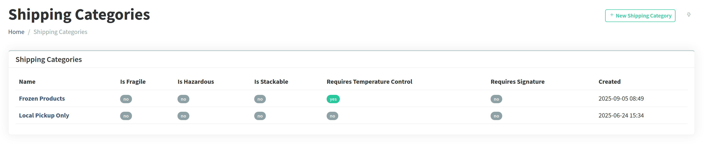
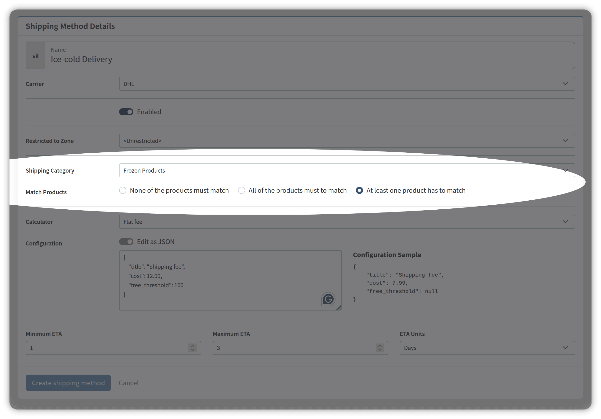

# Shipping

## Overview

The shipment module was designed to support the
[parcel delivery](https://en.wikipedia.org/wiki/Package_delivery) needs of
E-commerce businesses.

In the transportation planning jargon, this is also commonly referred to
as [Last mile transportation](https://en.wikipedia.org/wiki/Last_mile_(transportation)).

Albeit many shops, especially those with high shipping volumes need to deal
with [Freight forwarding](https://en.wikipedia.org/wiki/Freight_forwarder),
this module was not intended to support that part of the supply chain, but
it can serve as a data source for such operations.

## Shippables

The shipment module handles payments for arbitrary Eloquent models like orders
or individual products, etc. commonly referred to as "shippables".

`Shippable` is an interface defined in the `vanilo/contracts` package.
Any Eloquent model can implement this interface.

## Carriers

The `Carrier` model is stored in the `carriers` table and typically represents
a company that performs parcel delivery services, like DHL, UPS or local Post.

These carriers are also commonly referred to as _"last mile carriers"_.

Apart from that, if the shops delivers itself, it can also be listed as a carrier.
Carriers have an `is_active` flag which is true by default.

```php
use Vanilo\Shipment\Models\Carrier;

$dhlNl = Carrier::create(['name' => 'DHL Netherlands'])->fresh();
$dhlNl->is_active;
// true
```

Carrier objects have a configuration array which might be necessary for storing
credentials, service level, or any other carrier related configuration.

```php
$postNord = Carrier::create(['name' => 'Post Nord']);

$postNord->configuration = ['apikey' => '91f146137449a4068b3523a80xxx4f30'];
$postNord->save();
```

Carriers however, **are not equal to shipping methods**, which are the combinations of
a carrier, pricing and other configurations.

## Shipments

Shipments in the system are separate entities and are stored in the `shipments` table.
Each record/entity represents a single parcel. This can be a single item or a set of
items that is being delivered at once or handled as a single unit
(eg. identified by a tracking number) by the shipping carrier.

If the delivery of an order is split into multiple shipments, then each
shipment will have a new entry in the database.

> TO BE FINALIZED BY 9th March, 2022

## Shipping Categories

Shipping categories are used to group products with similar shipping rules, such as weight restrictions,
handling requirements, or carrier preferences.

They allow store owners to apply different shipping rates, methods, or conditions based on the product type
- for example, standard items, fragile goods, or oversized packages.

This makes shipping cost calculation and shipping method availability more accurate and flexible.



Shipping categories can be assigned to shipping methods and decided how the products influence the availability of
the shipping method.



## Shipping Methods

Shipping methods are the options that customers can choose from during checkout, like
"DHL Express", "Standard Post" or "Local Pickup".

The `ShippingMethod` model is stored in the `shipping_methods` table, and it combines the following:

- a **carrier** that performs the delivery,
- an optional **zone** where the shipping method is available,
- an optional **shipping category**, with a matching condition,
- a **fee calculator** that determines the shipping cost,
- a **configuration** array, that is passed to the fee calculator,
- an **ETA** range (see below).

This way the same carrier can have multiple shipping methods, eg. "DHL Standard" and "DHL Express",
or different pricing for domestic and international deliveries.

```php
use Vanilo\Shipment\Models\Carrier;
use Vanilo\Shipment\Models\ShippingMethod;

$dhl = Carrier::create(['name' => 'DHL']);

$dhlExpress = ShippingMethod::create([
    'name' => 'DHL Express',
    'carrier_id' => $dhl->id,
    'zone_id' => $germany->id,
    'calculator' => 'flat_fee',
    'configuration' => ['cost' => 9.99, 'free_threshold' => 150],
]);

$dhlExpress->carrier->name;
// "DHL"
```

Shipping methods have an `is_active` flag as well, which can be used to temporarily disable a
shipping method without deleting it:

```php
ShippingMethod::actives()->get();
ShippingMethod::inactives()->get();
```

To retrieve the active shipping methods of a given zone (or zones), use the following methods:

```php
ShippingMethod::availableOnesForZone($zone);
ShippingMethod::availableOnesForZones($zoneA, $zoneB);
```

> For the complete availability check at checkout (zones, categories, channels, etc.), use the
> `AvailableShippingMethods` class described below.

### Shipping Fee Calculators

The shipping fee of a shipping method is calculated by a fee calculator, which is set via the
`calculator` field. If no calculator is set, the `NullShippingFeeCalculator` is used, which always
returns a zero fee.

The following calculators are shipped with Vanilo:

| ID                          | Name                           | Configuration                                                         |
|-----------------------------|--------------------------------|-----------------------------------------------------------------------|
| `flat_fee`                  | Flat fee                       | `cost`, `free_threshold`, `title`                                     |
| `discountable_shipping_fee` | Discountable shipping fee      | `cost`, `free_threshold`, `discounted_threshold`, `discounted_cost`, `title` |
| `payment_dependent_fee`     | Payment dependent shipping fee | `prices` (keyed by payment method), `free_threshold`, `title`         |
| `weight_based_fee`          | Weight based shipping fee      | `ranges` (list of `min`, `max`, `price`), `title`                     |

Example configuration of a weight based shipping fee:

```php
ShippingMethod::create([
    'name' => 'DHL Germany',
    'calculator' => 'weight_based_fee',
    'configuration' => [
        'title' => 'Shipping fee',
        'ranges' => [
            ['min' => 0, 'max' => 1, 'price' => 4.99],
            ['min' => 1, 'max' => 2, 'price' => 6.99],
            ['min' => 2, 'max' => 5, 'price' => 9.99],
            ['min' => 5, 'max' => 10, 'price' => 14.99],
        ],
    ],
]);
```

To get the shipping fee for a given subject (eg. a cart or an order), call the `estimate()` method:

```php
$fee = $shippingMethod->estimate($cart);

$fee->amount()->getValue();
// 6.99
$fee->isEstimate();
// false
```

The `isEstimate()` method returns true if the calculator could not determine the final fee,
eg. because the subject wasn't passed, or it wasn't a `Shippable`.

Each calculator defines its configuration schema, which can be obtained via
`$shippingMethod->getConfigurationSchema()`. This is used to validate the configuration and to
render the configuration form in the admin panel.

#### Custom Calculators

If the built-in calculators don't fit your needs, you can write your own by implementing the
`Vanilo\Shipment\Contracts\ShippingFeeCalculator` interface, and registering it in your application's
service provider:

```php
use Vanilo\Shipment\ShippingFeeCalculators;

ShippingFeeCalculators::register('my_custom_fee', MyCustomFeeCalculator::class);
```

The calculator's `getAdjuster()` method returns the adjuster that applies the shipping fee to the
cart or order, if the adjustments module is in use.

### Shipping Method Availability

Every shop has different shipping rules and conditions.

To support this in a flexible way, a customizable class: `AvailableShippingMethods` has been added.

```php
use Illuminate\Http\Request;
use Vanilo\Checkout\Contracts\Checkout;
use Vanilo\Foundation\Shipping\Method\Eligibility\AvailableShippingMethods;

class CheckoutController extends Controller
{
    public function show(Request $request, Checkout $checkout)
    {
        return render('shop::checkout.show', [
            'checkout' => $checkout,
            'shippingMethods' => AvailableShippingMethods::forCheckout($checkout)->get(),
            // ...
        ]);    
    }
}
```

By default, the `AvailableShippingMethods` class checks the shipping method's availability based on the shipping
cart item products' shipping category and the shipping address' zones.

If you don't want any of the default checkers, you can instruct the class to skip them:

```php
use Vanilo\Foundation\Shipping\Method\Eligibility\AvailableShippingMethods;

AvailableShippingMethods::forCheckout($checkout)
    ->withoutZoneCheck()
    ->withoutCategoryCheck() 
    ->get();
```

You can add further checkers, e.g. the channel checker, which verifies that the shipping method is available for
the current channel:

```php
use Vanilo\Foundation\Models\Channel;
use Vanilo\Foundation\Shipping\Method\Eligibility\AvailableShippingMethods;
use Vanilo\Foundation\Shipping\Method\Eligibility\ChannelChecker;

$currentChannel = Channel::first(1);

AvailableShippingMethods::forCheckout($checkout)
    ->withoutZoneCheck()
    ->addChecker(new ChannelChecker($currentChannel)) 
    ->get();
```

You can write your own checkers, by implementing the `Vanilo\Foundation\Shipping\Method\Eligibility\Checker` interface
and adding it to the `AvailableShippingMethods` instance by calling the `addChecker()` method.

### Shipping Method ETA

E-commerce shipping ETA ranges, like "delivers in 24–48 hours" help set clear customer expectations by showing when
an order is likely to arrive.

They can also be used in checkout and product pages to increase trust and influence buying decisions.

To support this, 3 ETA fields have been added to the shipping method model:

- minimum
- maximum
- unit (days, hours, minutes, etc)
